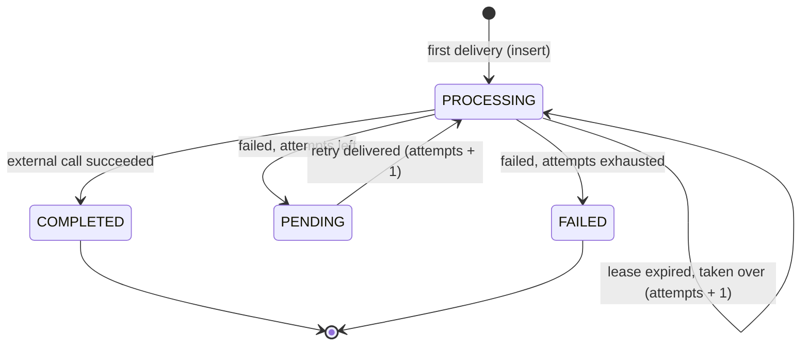

# Architecture

## What section 3 of the assignment implies

| Condition | Consequence for the design |
|---|---|
| 1000 events/min x 5 s each, growing | About 83 events in flight at any time. Processing must be asynchronous and parallel; the work is I/O wait, not CPU. |
| Senders retry and duplicate | Idempotency has to be enforced by the database, not by hope. |
| No ordering guarantee between events | Arrival order is not event order. Needs an explicit, documented strategy. |
| Same patient: sequence matters | Two events of one patient must never run at the same time. |
| Never lost, never counted twice | At-least-once delivery + idempotent processing. A confirmed write must precede every "OK". |
| Processes die at arbitrary moments | Every step must be resumable; ownership of an event must expire. |
| Sender gets an immediate answer | The request path only hands the event to a durable broker. |

## Components

```
sender --POST--> API process --publish + confirm--> RabbitMQ --deliver--> Worker process --> External system
                    |                                  ^  |                    |
                    | 202 {eventKey}                   |  +-- retry queues     v
                    v                                  |      dead-letter     MongoDB (events)
                 sender                                +----- queue           source of truth for state/result
```

| Component | Responsibility |
|---|---|
| API process (`src/main.ts`) | Validates the body (Zod), computes the event key, publishes to RabbitMQ (persistent + publisher confirm), answers 202 only after the confirm. Serves `GET /events/:key`, the OpenAPI document and Scalar. Does no processing and no database write on the request path. |
| Worker process (`src/worker.ts`) | Consumes the partition queues with manual acks, claims each event in MongoDB, calls the external system, records the result, decides retry / dead-letter. |
| RabbitMQ | Reliable asynchronous delivery, per-patient serialisation (partition queues), delayed retries (TTL queues), dead-letter queue. |
| MongoDB (`events` collection) | The only store of event state and result. A unique index on `eventKey` is the idempotency guarantee. |

Code layout: `events/` (schema, key, repository = every state transition),
`messaging/` (topology + broker), `ingest/` (HTTP), `processing/` (consumer,
processor, simulated external system), `config/`.

## Event flow

1. `POST /events`: validate, compute `eventKey`, publish to `events.p<N>` where `N = crc32(patientId) % PARTITIONS`, wait for the broker confirm, answer `202 {eventKey}`. If the confirm fails or times out (5 s) the answer is `503`: nothing was accepted, the sender retries.
2. The worker receives the message (one in flight per queue) and **claims** the event in MongoDB.
3. Claimed: call the external system, then write `COMPLETED` + result, then ack.
4. Failure: write `PENDING` (+ error), publish to the retry queue for the current backoff step, ack. After the last attempt: write `FAILED`, publish to the dead-letter queue, ack.
5. A message is acked only after its outcome is durable: result in MongoDB, or the retry/dead-letter copy confirmed by the broker.

## Event states



An event does not exist in MongoDB until a worker first claims it; until then it
lives in RabbitMQ (see trade-offs). Each document records `status`, `attempts`,
`lockedUntil` (lease), `lastError`, `result`, `outOfOrder`, `receivedAt`,
`completedAt`.

That answers the questions of the brief: already processed = `COMPLETED`; being
processed = `PROCESSING` with a live `lockedUntil`; attempts = `attempts`; final
result = `result`; resumable after a crash = a `PROCESSING` document whose lease
expired.

## Idempotency

The payload has no provider event ID, so identity is a **fingerprint**:
`eventKey = sha256(patientId, type, ts as UTC ISO, data with sorted keys)`. The
same event re-sent with reordered JSON keys or another timestamp notation gets the
same key.

- Enforced by a **unique index on `eventKey`**. The worker claims with an insert; a duplicate-key error means "already known", never "process again".
- Duplicates are deliberately **not filtered in the API**: every POST is published, the worker drops the redundant ones in one cheap query. That keeps the API stateless and the correctness in one place.
- Redelivery by RabbitMQ (crash before ack, requeue) goes through the same claim, so it is safe by construction.
- Every write after the claim is **fenced** by `attempts` (`updateOne({eventKey, status: PROCESSING, attempts})`). A worker that lost its lease can never overwrite the new owner's work.

**Limitation, stated plainly:** a fingerprint is not a provider ID. Two *distinct*
real-world events with identical patient, type, timestamp and data (e.g. two
identical readings in the same second) collapse into one, and an event the sender
corrects by changing `data` is a new event. If the senders can provide a stable
event ID, it should replace the fingerprint (one function: `eventKeyOf`).

## Retries

- Backoff steps `RETRY_DELAYS_MS` (default 5 s, 30 s, 2 min); max attempts = steps + 1 (4).
- One TTL queue per step (`events.retry.<step>`): all messages in a queue have the same TTL, so there is no head-of-line blocking (a per-message TTL on a single queue would only expire at the head). On expiry the broker dead-letters the message back to `events`, keeping its routing key, so it returns to its own partition queue.
- No immediate requeue anywhere on the failure path: a failing event can never spin.
- Exhausted -> `FAILED` in MongoDB and a copy in `events.dead`. State is written first: MongoDB is authoritative, the dead-letter copy is the operational convenience (a crash exactly between the two leaves `FAILED` without a copy).
- Unexpected errors (MongoDB unreachable while claiming) also go through the delay queues and are not counted as attempts.
- A message that cannot be parsed goes to the dead-letter queue as is.

## Ordering and concurrency

**Parallel across patients, serial within a patient.** `crc32(patientId) % 256`
picks one of 256 durable queues; each queue has `x-single-active-consumer` and
prefetch 1. RabbitMQ therefore delivers one message at a time per queue, to one
consumer, even with several workers. Different partitions are independent, so
~83 concurrent events use a third of the 256 partitions (capacity ~3000
events/min with a perfectly even spread).

**What "order" can and cannot mean here.** Events arrive out of order, and the
only ordering information is the sender's `ts`. An event older than ones already
applied can always arrive later, so absolute ordering is impossible without a
sender-provided sequence or an unbounded wait. The strategy:

1. Events of a patient are applied **one at a time in arrival order** (never overlapping).
2. The final state is meant to be resolved by `ts`: when an event completes and a newer-`ts` event of the same patient already completed, it is still processed and stored, but flagged `outOfOrder: true`, so consumers of the data can reconcile instead of silently trusting arrival order. Nothing is dropped.
3. A retried event re-enters its queue after its delay, so a later event of the same patient can overtake it. This is the same class of disorder as (2) and is flagged the same way; blocking the whole patient while one event backs off would let a single poisoned event stall a patient for minutes.

What was not built: a reorder buffer (hold events for a time window, process by `ts`). It adds latency and state, and still cannot be exact; it is the next step if the business needs stricter ordering.

## Crash recovery

- Not acked = redelivered: a worker dying mid-processing returns its message to the queue (and RabbitMQ promotes another consumer). The message is never lost because the ack comes last.
- The new delivery finds the document `PROCESSING` with a live lease -> deferred through a retry queue (not counted) until `lockedUntil` passes -> **taken over** with `attempts + 1`. Worst-case recovery time is therefore `LEASE_MS` (30 s) plus a retry delay. `LEASE_MS` must exceed `EXTERNAL_TIMEOUT_MS` (validated at startup), otherwise a live attempt could be taken over.
- An event that keeps killing its workers still ends: attempts grow on every takeover, and beyond the maximum it is dead-lettered without running again.
- Graceful shutdown (deploys): consumers are cancelled, in-flight events are drained (up to 25 s) before the connection closes.
- API side: the broker connection reconnects automatically and redeclares the topology; while it is down publishes wait up to 5 s and then answer 503.

## Scaling

The work is I/O wait, so one worker process handles hundreds of concurrent events
(256 consumers, one in flight each). Capacity grows with `PARTITIONS`, not with
the number of workers. Extra workers are **hot standbys**: with single active
consumer, RabbitMQ picks one active consumer per queue, normally the first to
register, so a second worker takes over on failure but does not share load
evenly. If CPU or memory of one process ever becomes the limit, assign partition
ranges per worker (a small change in `EventConsumer`).

`PARTITIONS` is part of the routing: changing it re-maps patients. Change it only
with drained queues (otherwise a patient's old and new messages could overlap).

## Trade-offs accepted

| Decision | Upside | Downside |
|---|---|---|
| RabbitMQ is the intake log; no DB write in the API | One durable write on the hot path, no dual-write problem, no sweeper needed | A just-accepted event is invisible in MongoDB (`GET` answers 404) until a worker claims it. Losing the broker's disk loses unprocessed events. |
| Content fingerprint instead of an event ID | Works with the contract as given | Collapses genuinely identical events (see Idempotency) |
| Partition queues + single active consumer | Ordering without distributed locks, failover for free | Head-of-line blocking inside a partition (a slow event delays unrelated patients on the same partition); fixed partition count; standby workers do not balance load |
| Flag late events, don't reorder | Simple, nothing lost, honest about the limits | Consumers must use `ts`/`outOfOrder` to resolve state |
| Lease + fencing in MongoDB instead of transactions | Works on a standalone MongoDB, cheap | Recovery takes up to `LEASE_MS`; a worker paused longer than the lease may call the external system twice (its writes are discarded, the external call is not undone; the external system must tolerate it, ideally via an idempotency key) |
| Classic durable queues | Simple, fine on a single node | In a cluster use quorum queues (they also support single active consumer) |
| Nest's default exception filter | Consistent JSON errors, less code | No custom error codes |

## What I would do with more time

- Reorder buffer or sender-provided sequence numbers for strict ordering.
- Provider event ID / `Idempotency-Key` support, keeping the fingerprint as fallback.
- Per-patient fencing in MongoDB for the zombie-consumer case (broker thinks a consumer is dead while it still runs: two events of one patient could briefly overlap; per-event state stays correct thanks to fencing).
- Partition ranges per worker, quorum queues, a replay tool for the dead-letter queue.
- Health/readiness endpoints, metrics (queue depth, attempts, age of oldest PENDING) and structured logging.
- Pass an idempotency key to the real external system.
